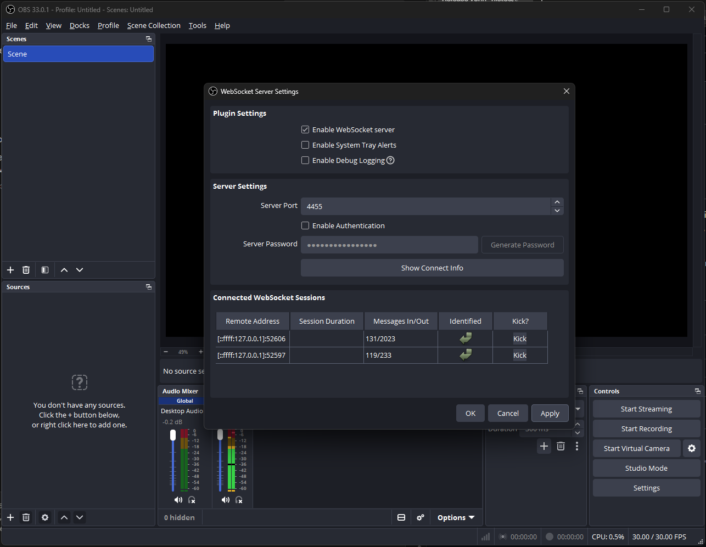

## OBS Audio

An audio desk for OBS Studio. It gives you:

- an auto gain rider and calibrate on each input
- Intech Grid (or any MIDI) faders with pickup
- PFL and solo on OBS's monitoring
- automatic switching to backup feeds
- recording control with a planned restart
- OBS's own processing filters and recording tracks
- a fader and meter page in any browser, or as an OBS dock

It runs alongside the official OBS module. Both can be connected to OBS at once.

### Setup

**1. Turn on OBS's WebSocket server.** It's off by default. In OBS: **Tools → WebSocket Server Settings**:

- tick **Enable WebSocket server**
- note the **Server Port** (normally 4455)
- either untick **Enable Authentication**, or press **Show Connect Info** and copy the **Server Password**

**2. Add this connection** and enter:

- OBS's address: `127.0.0.1` if OBS is on this computer
- the port
- the password, or blank if authentication is off

Every field can take a Companion variable, such as `$(custom:obs_ip)`. Hover over a field for what it does.

**3. Open the fader page.** The connection's page shows its address as a link. You can also use:

- the **Open the fader page** preset
- the `$(OBS_Audio:page_url)` variable
- `http://<this computer's address>:8890/`

**Fader page available on** sets who can open it: every network, this computer only, or one network. Set a PIN if others on the network shouldn't change things.

**4. To use it inside OBS:** **Docks → Custom Browser Docks**, then add the same address.

#### If it won't connect

The connection's status says why, in plain words:

- **Can't reach OBS:** OBS isn't running, its WebSocket server is off, or the address or port is wrong.
- **Password is wrong:** copy it again from Show Connect Info, or turn authentication off.
- **Lost the connection:** OBS closed, or the network dropped. It keeps trying.

If OBS is on another computer, its firewall must allow the port.

### The fader page

Each input is a strip, like a sound desk. From left to right:

- **Fader and meters.** PRE is the level before the fader; POST is what's recorded. Each strip has PRE / POST / FINE buttons, and the meter shows the rider's target line and band. Drag the fader; use FINE (or two fingers) for small moves; double tap for 0 dB.
- **Channel settings.** Basic auto gain sits at the top, with sections of controls under it. Knobs work by dragging up and down: Shift for fine, double click to reset, click the value to type one.
- **Show advanced.** Opens every auto gain and backup setting over the channel settings. **Pin** keeps it open as a third column.
- **MUTE / PFL / SOLO** at the bottom of each strip.

Drag a strip's right edge to change its width. Tick **Match widths** to size them all together.

Every page setting is in **⚙ Settings**, a floating panel you can drag aside while you keep working. It's also available from Companion with **Fader page: change a setting**. That includes:

- layout, colours and meters
- tooltips on or off
- tip of the day on or off

Sections are yours to arrange: in **Settings → Sections**, add, rename and reorder them, and choose what's in each and whether each is hidden, always open or collapsible. **Settings → Inputs** overrides that per input, and orders or hides inputs.

**Settings → Export / import** exports everything. On import, tick what to apply. The settings in use are kept as an autosave first, so an import can be rolled back.

### PFL and solo

PFL and solo only ever change OBS's **monitoring** (your headphones). The stream and the recording are never touched. Set the monitoring device in OBS: **Settings → Audio → Advanced → Monitoring Device**.

- **PFL** sets an input's monitoring to "Monitor and Output". In the header, **PFL ADD** means PFLs add up; **PFL EXCL** means a new PFL cancels the others.
- **SOLO** lets you hear just one input. It works only while held, unless **Solo latch** is ticked. When solo ends, every PFL goes back to how it was.

### Backup feeds

You can make an input the backup of another, for example a second radio mic on the same presenter. In the backup's strip, go to **Input → Backup for**, then turn on **Auto switch** under Show advanced → Backup feed.

If the main drops out, or goes much louder or quieter than usual against the backup, while the backup is healthy, it crossfades to the backup and a pop-up says why. **It never switches back by itself.** When the main has looked healthy for a while, a pop-up offers:

- **Take** the main
- **Snooze**
- **Swap roles**: the backup becomes the main
- **Dismiss**

Every threshold and time is a setting.

### Recording

- **● REC** in the header starts OBS recording. Pressing it while recording asks "Stop recording?", then "Are you definitely sure?".
- After stopping, it asks when recording is due to restart, with an option to start automatically. Skip leaves it stopped.
- A planned start shows as a countdown in the header. If it isn't automatic, a large **Start recording?** pop-up appears 10 minutes before (a setting), offering Start, Snooze, Set a new time and Dismiss. Nothing blocks the page.
- **Settings → Recording** sets OBS's recording folder and file name format (put a prefix before OBS's date codes). It also shows the last file, and how many recordings are in the folder when OBS is on this computer.

### Auto gain

Each input has a **rider** (on/off) and **calibrate**.

- **This level please:** set the fader by ear, then capture that level as the target. The rider leaves it alone while the level stays inside the band, and rides it back when it drifts out.
- **Calibrate:** brings the input to a set level once, then stops.
- **The input button** (the per-input preset "AG"):
  - **press** = this level please
  - **double tap** = calibrate to the input's own level
  - **press and hold** = calibrate to the module level

  Timings are in Settings → Buttons.

What it moves is a setting per input:

- the **OBS fader**: it measures after the fader
- a **trim**: a Gain filter it adds before the fader. It measures before the fader, so the fader stays yours.

Every setting has a page-wide default (Settings → Auto gain defaults) and can be changed per input under Show advanced. Changed values show purple, and ↺ puts one back to the default.

If the rider moves the fader on an input, a Grid fader latched to that input lets go each time, because that counts as an outside move. Ride the trim instead to keep both.

### Intech Grid faders

Use **Fader: from a value (Intech Grid fader), with pickup** in a trigger that runs when the Grid fader's value changes, with the fader's value as **Value**.

- Fader 1 drives the first input in the list, fader 2 the second, and so on, unless an input is given.
- Pickup works as in the SQ module extension: catch band and dwell, then latched until OBS is moved elsewhere (release band and time).
- The catch and release settings belong to each connection: set them on the connection page, under **Grid fader pickup**. A main and a backup OBS connection each have their own. They also show as variables (`grid_catch_band`, `grid_dwell_ms`, `grid_release_band`, `grid_release_ms`). A value typed into an action overrides the connection's setting for that action only.
- Show it on the fader's LED with the **Grid fader pickup LED** feedback.

### Presets

**Overall:**

- open the fader page, and its address
- connection status
- update available
- every rider on or off
- record
- next planned start
- pop-ups waiting

**Per input:**

- the AG button, rider, status, this level and the two calibrates
- mute, PFL, solo (hold and latch)
- level, fader ±1 / ±3 / 0, trim ±1
- recording tracks
- filter on/off
- backup switch

### Action recorder

Companion's action recorder captures changes made on the fader page, and changes made in OBS itself, as this module's actions:

- fader, mute, balance, sync and trim
- tracks
- filters

### Variables

Per input, numbered in list order (`in1_` …):

- name, fader, trim, mute, balance, sync, monitoring, tracks
- PFL and backup state
- rider status and target, calibrate level
- meters (`level`, `rms`, `peak`, `pre`)
- every filter's settings

Overall:

- `page_url`
- `obs_error`
- recording: `rec_state`, `rec_time`, `rec_next`, `rec_countdown`, `rec_auto`, `rec_folder`, `rec_files`
- `solo`
- `notices`

### Notes

- The input list follows OBS's input order, which isn't always the order of OBS's mixer. Reorder it in Settings → Inputs.
- obs-websocket doesn't report gain reduction from OBS's compressor and limiter, so there are no gain-reduction meters.
- The page uses web fonts when online and falls back to built-in fonts at a venue without internet.
